<div dir="rtl">

# راهنمای کامل کاربر شمسا (نسخه ۳.۱)

شمسا یک دستیار سبک و آفلاین برای ویندوز ۱۰ و ۱۱ است: پیش‌نمایش فایل‌ها کنار موس، منوی دایره‌ای تبدیل فرمت، ابزارهای نظم‌دهی، ضبط صفحه، استودیو پوشه و یک **محیط دسکتاپ کامل و اختیاری** (نوار بالا، داک، جستجوی سریع، مدیر پنجره، ویجت‌ها و …).

> همه تصویرهای این راهنما از پنجره‌های خود شمسا گرفته شده‌اند. در یکی از تصویرها نام فایل‌ها برای حفظ حریم خصوصی محو شده است.

## فهرست

1. [نصب و اولین اجرا](#۱-نصب-و-اولین-اجرا)
2. [داشبورد شمسا](#۲-داشبورد-شمسا)
3. [پیش‌نمایش شناور فایل‌ها](#۳-پیشنمایش-شناور-فایلها)
4. [منوی دایره‌ای و قفسه موقت](#۴-منوی-دایرهای-و-قفسه-موقت)
5. [ابزارهای نظم‌دهی](#۵-ابزارهای-نظمدهی)
6. [ضبط صفحه و اسکرین‌شات](#۶-ضبط-صفحه-و-اسکرینشات)
7. [استودیو پوشه: آیکون دلخواه و قفل رمزدار](#۷-استودیو-پوشه-آیکون-دلخواه-و-قفل-رمزدار)
8. [تنظیمات، ظاهر و به‌روزرسانی](#۸-تنظیمات-ظاهر-و-بهروزرسانی)
9. [محیط دسکتاپ شمسا](#۹-محیط-دسکتاپ-شمسا)
10. [جدول کلیدهای میانبر](#۱۰-جدول-کلیدهای-میانبر)
11. [حریم خصوصی، عیب‌یابی و پرسش‌های رایج](#۱۱-حریم-خصوصی-عیبیابی-و-پرسشهای-رایج)

---

## ۱. نصب و اولین اجرا

1. فایل `Shamsa-Setup-v3.1.0-win-x64.exe` را از بخش [Releases](https://github.com/seyedebrahim0211-oss/Shamsa/releases) دانلود و اجرا کنید.
2. فایل نصب امضای دیجیتال ندارد. اگر SmartScreen هشدار داد، روی **More info** و بعد **Run anyway** بزنید.
3. نصب‌کننده همه چیز را با خودش دارد (Runtime دات‌نت، موتور VLC و فونت وزیرمتن). چیز دیگری لازم نیست.
4. بعد از نصب، آیکون شمسا کنار ساعت ویندوز (System Tray) ظاهر می‌شود. شمسا بی‌سروصدا در پس‌زمینه کار می‌کند.

- **کلیک** روی آیکون سینی: باز کردن داشبورد.
- **کلیک‌راست** روی آیکون سینی: همه ابزارها، از جمله ضبط صفحه، استودیو پوشه، استودیو دسکتاپ، جستجوی سریع، مرکز کنترل، «بازگردانی دسکتاپ ویندوز» و خروج.
- اگر شمسا را دوباره اجرا کنید، نسخه دوم باز نمی‌شود و همان برنامه در حال اجرا داشبوردش را نشان می‌دهد.
- گزینه «اجرا با شروع ویندوز» در منوی سینی است.

---

## ۲. داشبورد شمسا

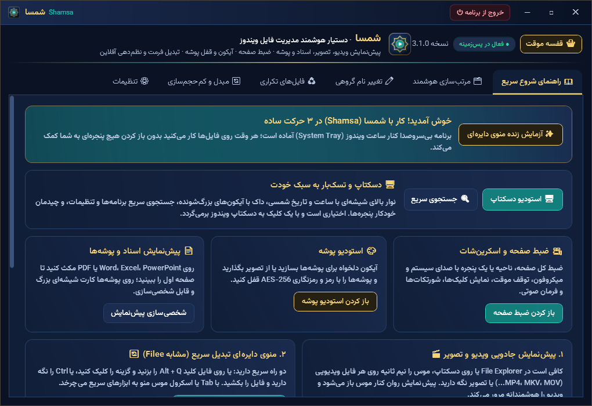

داشبورد شش تب دارد:

| تب | کاربرد |
|---|---|
| 📖 راهنمای شروع سریع | معرفی قابلیت‌ها و دکمه‌های میان‌بر به استودیو دسکتاپ، جستجوی سریع، ضبط صفحه و استودیو پوشه |
| 🗂 مرتب‌سازی هوشمند | دسته‌بندی فایل‌های یک پوشه شلوغ |
| ✏️ تغییر نام گروهی | تغییر نام ده‌ها فایل با یک قانون |
| ♻️ فایل‌های تکراری | پیدا کردن و حذف امن نسخه‌های تکراری |
| 🔄 مبدل و کم‌حجم‌سازی | تبدیل فرمت و کاهش حجم عکس، ویدیو و صوت |
| ⚙️ تنظیمات | ظاهر، پیش‌نمایش‌ها، میانبرها، FFmpeg و به‌روزرسانی |

دکمه **قفسه موقت** بالای پنجره، قفسه را باز می‌کند (بخش ۴).

---

## ۳. پیش‌نمایش شناور فایل‌ها

کافی است در File Explorer یا روی دسکتاپ، **موس را نیم ثانیه روی یک فایل نگه دارید**. هیچ کلیکی لازم نیست و فایل باز یا قفل نمی‌شود.

### ویدیو و تصویر
- ویدیوها کنار موس پخش می‌شوند و پنجره خودش را با ابعاد افقی، عمودی یا مربعی فایل هماهنگ می‌کند.
- با حرکت موس روی ویدیو، زمان‌های مختلف آن مرور می‌شود.
- عکس‌های گوشی با چرخش درست (EXIF) نمایش داده می‌شوند.

### اسناد (Word، Excel، PowerPoint، PDF و متن)

| Word | Excel | PowerPoint | PDF |
|---|---|---|---|
| 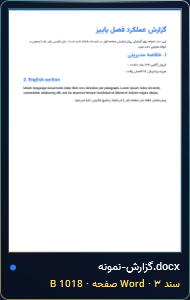 | 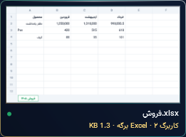 | 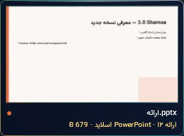 | 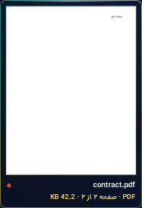 |

- صفحه اول سند، برگه اول اکسل یا اسلاید اول پاورپوینت نمایش داده می‌شود. متن فارسی راست‌به‌چپ درست است.
- پایین کارت، تعداد صفحه، برگه یا اسلاید نوشته می‌شود.
- **PDF چندصفحه‌ای:** تا وقتی موس روی فایل است، صفحه‌ها (تا ۱۲ صفحه) هر ۱.۷ ثانیه خودکار ورق می‌خورند و «صفحه n از m» نمایش داده می‌شود.
- فرمت‌های پشتیبانی‌شده: `docx`، `xlsx`، `pptx`، `pdf`، `odt`، `ods`، `odp`، `md`، `txt`، `csv`، فایل‌های کد، و `doc`/`xls`/`ppt` قدیمی (از طریق تصویر بندانگشتی ویندوز).

### پوشه‌ها: کارت شیشه‌ای بزرگ

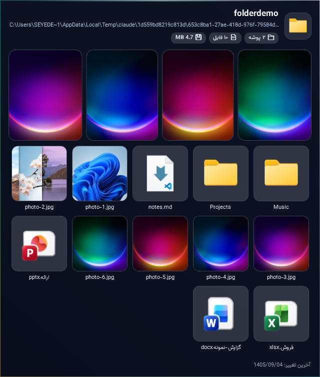

موس را روی یک پوشه نگه دارید تا محتوای آن را در یک کارت شیشه‌ای ببینید: تعداد پوشه‌ها و فایل‌ها، حجم، عکس‌ها و ویدیوها به‌صورت گالری، و تاریخ آخرین تغییر به شمسی.

**شخصی‌سازی** (داشبورد ← تنظیمات ← کارت پوشه):
- سبک نمایش: شبکه، گالری یا فهرست.
- پهنای کارت، اندازه کاشی‌ها و حداکثر تعداد موارد.
- رنگ و تیرگی شیشه، گردی گوشه‌ها، نمایش نام فایل‌ها، مرتب‌سازی و انیمیشن بزرگ‌شدن.
- دکمه «نمایش آزمایشی» برای دیدن فوری نتیجه.

برای خاموش کردن هر نوع پیش‌نمایش (ویدیو، تصویر، سند، پوشه) هم گزینه جدا در تنظیمات هست.

---

## ۴. منوی دایره‌ای و قفسه موقت

### منوی دایره‌ای تبدیل سریع
دو راه برای باز کردن:
1. یک یا چند فایل را انتخاب کنید و **`Alt + Q`** بزنید.
2. **`Ctrl`** را نگه دارید و فایل را کمی بکشید.

بعد گزینه را کلیک کنید. با `Tab` یا چرخ موس بین ابزارها جابه‌جا شوید: تبدیل به MP4، MP3، JPG یا WEBP، کم‌حجم‌سازی، فشرده‌سازی، فرستادن به قفسه و …

- کلید میانبر از «تنظیمات» قابل تغییر است.
- برای دیدن منو بدون فایل، در تب «راهنمای شروع سریع» دکمه **آزمایش زنده منوی دایره‌ای** را بزنید.

### قفسه موقت (Drop Shelf)
جایی برای جمع کردن موقت فایل‌ها از پوشه‌های مختلف. فایل‌ها را روی قفسه بکشید و بعد همه را با هم به مقصد بکشید.

---

## ۵. ابزارهای نظم‌دهی

### مرتب‌سازی هوشمند
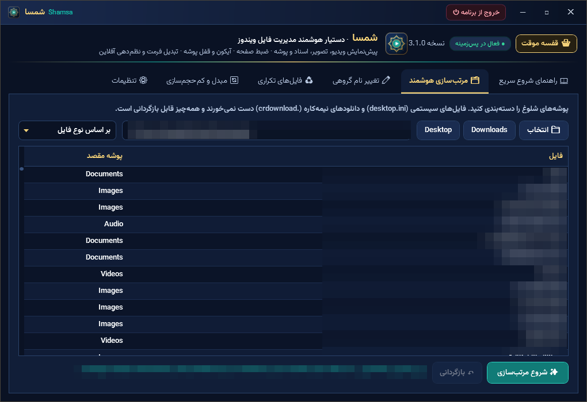

1. پوشه را انتخاب کنید (یا دکمه‌های **Downloads** و **Desktop**).
2. روش دسته‌بندی را انتخاب کنید (مثلاً «بر اساس نوع فایل»).
3. در پیش‌نمایش ببینید هر فایل به کدام پوشه (Images، Documents، Videos، …) می‌رود.
4. **شروع مرتب‌سازی** را بزنید. با **بازگردانی** همه‌چیز به حالت قبل برمی‌گردد.

فایل‌های سیستمی (`desktop.ini`) و دانلودهای نیمه‌کاره دست نمی‌خورند. گزینه «مرتب‌سازی خودکار» در منوی سینی، یک پوشه را دائم مرتب نگه می‌دارد.

### تغییر نام گروهی
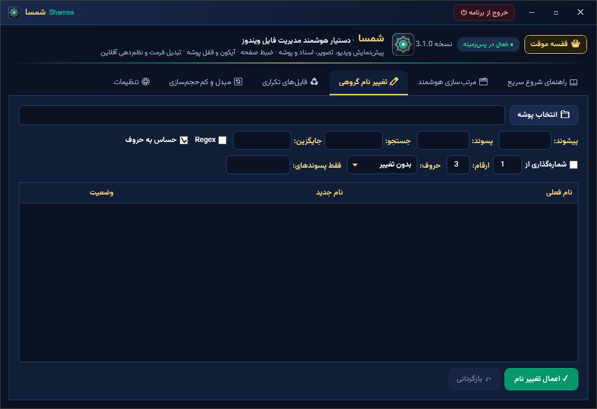

پیشوند، پسوند، جستجو و جایگزینی (با Regex)، شماره‌گذاری با تعداد رقم دلخواه و تغییر حروف بزرگ و کوچک. قبل از اعمال، ستون «نام جدید» نتیجه را نشان می‌دهد و **بازگردانی** همیشه در دسترس است.

### فایل‌های تکراری
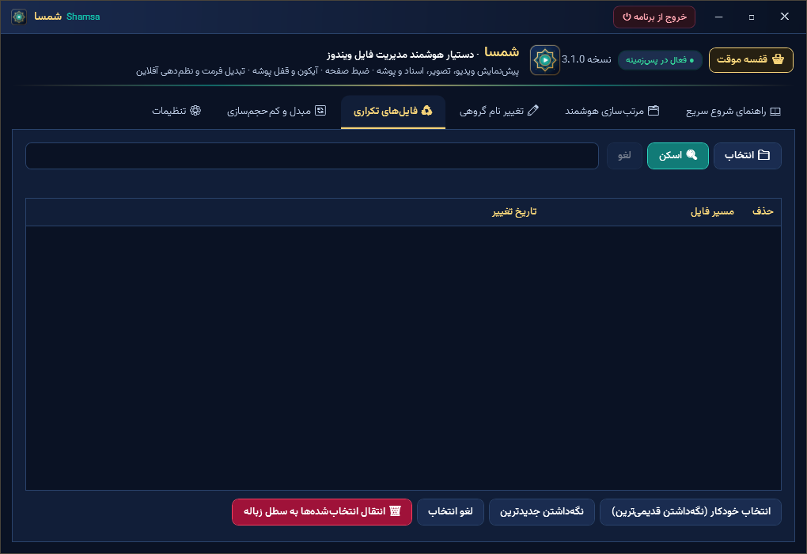

پوشه را انتخاب و **اسکن** کنید. تکراری‌ها با محتوای یکسان (نه فقط نام) پیدا می‌شوند. با «انتخاب خودکار» قدیمی‌ترین یا جدیدترین نسخه نگه داشته می‌شود. حذف به **سطل بازیافت** است، نه حذف دائم.

### مبدل و کم‌حجم‌سازی
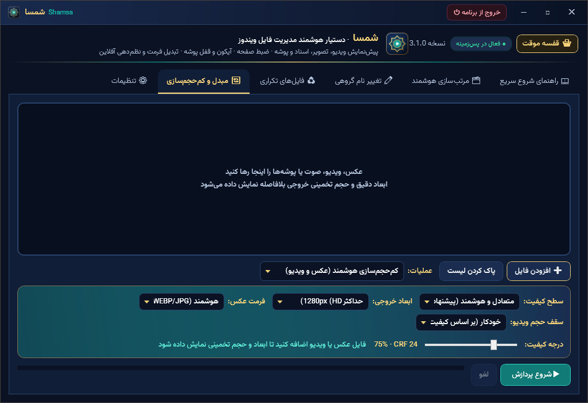

فایل‌ها را داخل کادر بکشید. عملیات، سطح کیفیت، حداکثر ابعاد و فرمت عکس را انتخاب کنید. ابعاد و حجم تخمینی خروجی فوراً نمایش داده می‌شود. برای ویدیو و صوت، FFmpeg لازم است و از تنظیمات با یک کلیک نصب می‌شود.

---

## ۶. ضبط صفحه و اسکرین‌شات

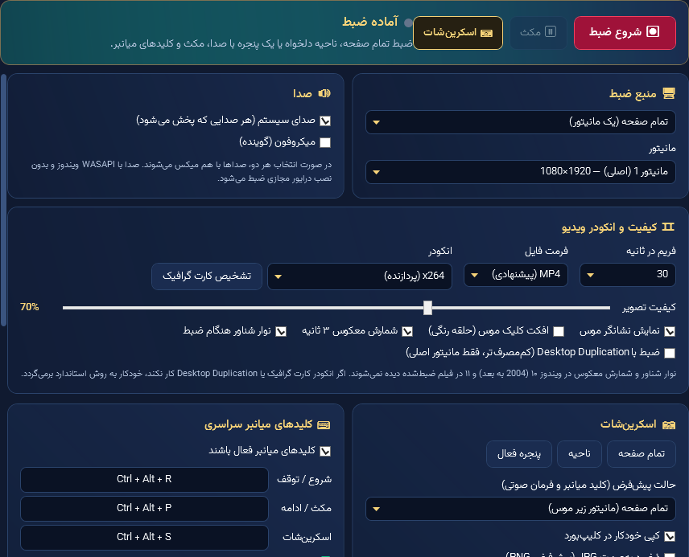

باز کردن: منوی سینی ← «ضبط صفحه»، یا داشبورد ← «باز کردن ضبط صفحه»، یا **`Ctrl + Alt + R`**.

- **ناحیه ضبط:** کل صفحه، یک ناحیه دلخواه (با موس بکشید) یا یک پنجره.
- **صدا:** صدای سیستم و/یا میکروفون.
- **کیفیت:** نرخ فریم، کیفیت و استفاده از انکودر کارت گرافیک.
- **ظاهر:** نمایش کلیک‌های موس و شمارش معکوس قبل از شروع.
- نوار کوچک ضبط روی صفحه، زمان را نشان می‌دهد و دکمه مکث و توقف دارد.

| کلید | کار |
|---|---|
| `Ctrl + Alt + R` | شروع / توقف ضبط |
| `Ctrl + Alt + P` | مکث / ادامه |
| `Ctrl + Alt + S` | اسکرین‌شات |

فرمان صوتی انگلیسی پنجره ضبط («start recording»، «take screenshot») از همان پنجره روشن می‌شود. برای فرمان فارسی بخش ۹-۱۱ را ببینید.

---

## ۷. استودیو پوشه: آیکون دلخواه و قفل رمزدار

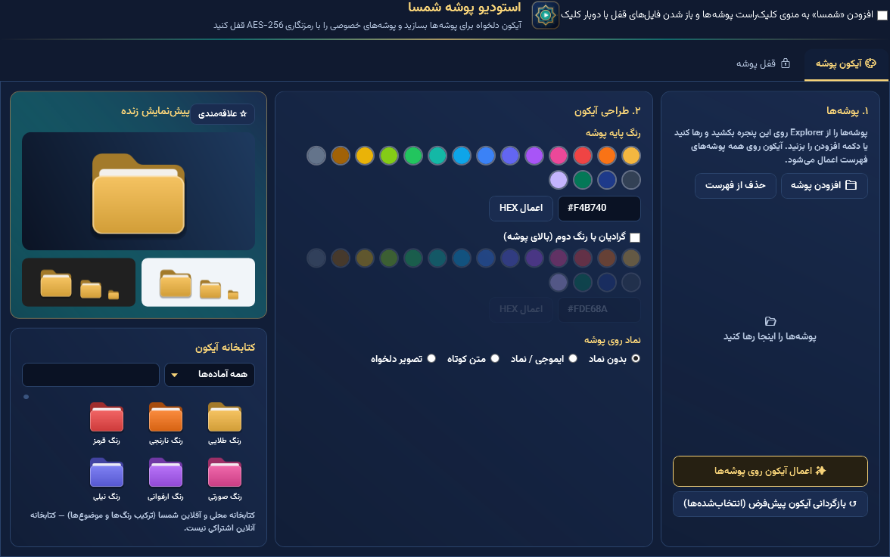

باز کردن: منوی سینی ← «استودیو پوشه»، یا داشبورد ← «باز کردن استودیو پوشه».

### آیکون دلخواه پوشه
1. پوشه یا پوشه‌ها را انتخاب کنید (اعمال گروهی هم ممکن است).
2. رنگ یا گرادیان را انتخاب کنید و یک ایموجی، متن کوتاه یا تصویر روی آن بگذارید.
3. **اعمال** را بزنید. آیکون در Explorer عوض می‌شود.

طرح‌ها در کتابخانه، علاقه‌مندی‌ها و تاریخچه می‌مانند. «حذف آیکون» پوشه را به حالت عادی برمی‌گرداند.

### قفل پوشه با رمز
- پوشه با **AES-256-GCM** رمزنگاری می‌شود و بدون رمز قابل باز کردن نیست.
- **رمز را فراموش نکنید.** هیچ راه بازیابی وجود ندارد.
- برای باز کردن، روی پوشه قفل‌شده دوبار کلیک کنید یا از استودیو «باز کردن قفل» را بزنید.

### منوی کلیک‌راست Explorer (اختیاری)
با روشن کردن این گزینه در استودیو، دو گزینه «استودیو پوشه» و «قفل پوشه» به منوی کلیک‌راست پوشه‌ها اضافه می‌شوند. این تغییر فقط برای حساب کاربری شماست و با حذف شمسا پاک می‌شود.

---

## ۸. تنظیمات، ظاهر و به‌روزرسانی

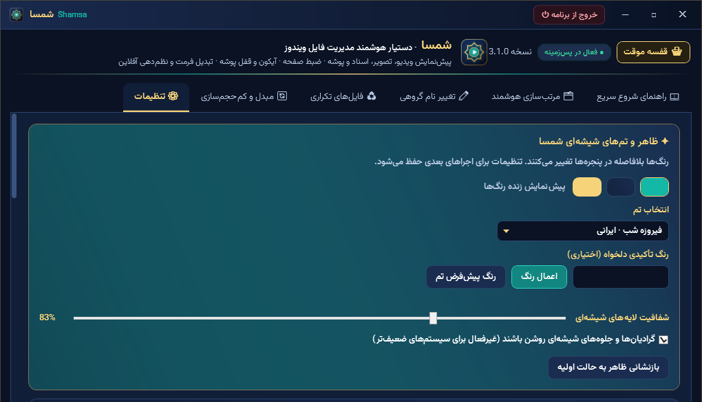

- **تم‌های شیشه‌ای:** فیروزه شب ایرانی، لاجوردی، زمردی و یاقوتی؛ رنگ تأکیدی دلخواه با کد HEX؛ میزان شفافیت لایه‌ها.
- **فونت:** وزیرمتن داخل برنامه است. فونت دیگری را از «استودیو دسکتاپ ← ظاهر و فونت» انتخاب کنید (بعد از اجرای دوباره کامل اعمال می‌شود).
- **پیش‌نمایش‌ها:** روشن و خاموش کردن هر نوع، اندازه پنجره پیش‌نمایش، تنظیمات کارت پوشه.
- **میانبر منوی دایره‌ای**، **FFmpeg** (نصب یا تعیین مسیر) و «اجرا با شروع ویندوز».

### به‌روزرسانی هوشمند
- شمسا هر چند ساعت نسخه تازه را در گیت‌هاب بررسی می‌کند و در پس‌زمینه دانلود می‌کند. فایل با کد SHA-256 تأیید می‌شود.
- **نصب یک‌کلیکی:** بی‌صدا نصب می‌شود و برنامه خودش دوباره باز می‌شود.
- می‌توانید یادداشت تغییرات را ببینید یا یک نسخه را رد کنید.
- گزینه «نصب خودکار هنگام بیکاری سیستم» به‌روزرسانی را وقتی پشت سیستم نیستید انجام می‌دهد.

---

## ۹. محیط دسکتاپ شمسا

محیطی شبیه Seelen UI و macOS، کاملاً **اختیاری و پیش‌فرض خاموش**. تا وقتی روشنش نکنید، هیچ چیزی در دسکتاپ ویندوز تغییر نمی‌کند.

### ۹-۱. استودیو دسکتاپ و شروع سریع

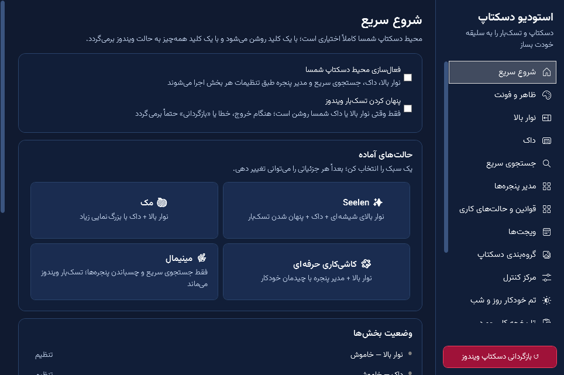

باز کردن: منوی سینی ← «استودیو دسکتاپ»، یا دکمه **استودیو دسکتاپ** در داشبورد، یا کلیک‌راست روی دکمه شمسا در نوار بالا.

1. تیک **«فعال‌سازی محیط دسکتاپ شمسا»** را بزنید.
2. یکی از **حالت‌های آماده** را انتخاب کنید:
   - ✨ **Seelen:** نوار بالا، داک و پنهان شدن تسک‌بار.
   - 🍏 **مک:** داک با بزرگ‌نمایی زیاد.
   - 🧩 **کاشی‌کاری حرفه‌ای:** نوار بالا و چیدمان خودکار پنجره‌ها.
   - 🌿 **مینیمال:** فقط جستجو و چسباندن پنجره‌ها؛ تسک‌بار ویندوز می‌ماند.
3. هر بخش را از فهرست کنار پنجره جداگانه تنظیم کنید. **هر تغییر همان لحظه اعمال و ذخیره می‌شود.**

> **دکمه قرمز «بازگردانی دسکتاپ ویندوز»** همیشه پایین استودیو و در منوی سینی هست. همه بخش‌ها را خاموش می‌کند و تسک‌بار ویندوز را برمی‌گرداند. اگر شمسا ببندد یا خطا بدهد، تسک‌بار خودکار برمی‌گردد.

### ۹-۲. ظاهر و فونت
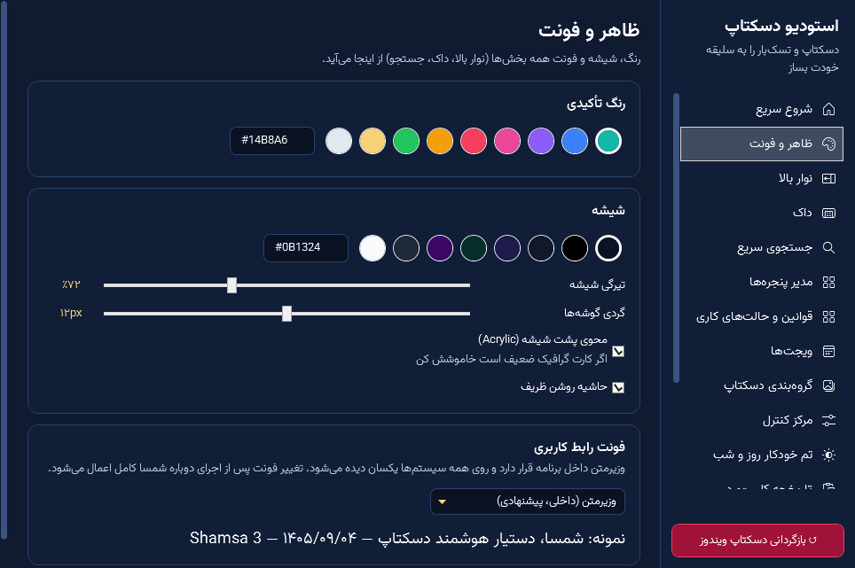

رنگ تأکیدی، رنگ و تیرگی شیشه، گردی گوشه‌ها، حاشیه روشن و فونت رابط کاربری. این تنظیمات روی نوار بالا، داک، جستجو و ویجت‌ها با هم اعمال می‌شوند.

### ۹-۳. نوار بالا
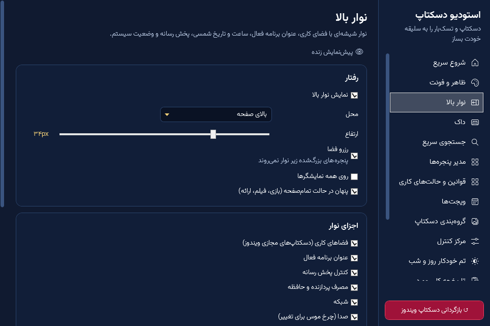

نوار شیشه‌ای بالای صفحه که این اجزا را دارد:
- **دکمه شمسا:** کلیک = جستجوی سریع؛ کلیک‌راست = استودیو.
- **فضاهای کاری:** دسکتاپ‌های مجازی ویندوز؛ با کلیک بین آن‌ها جابه‌جا شوید.
- **عنوان برنامه فعال.**
- **ساعت و تاریخ شمسی:** کلیک = تقویم ماه با تعطیلات.
- **پخش رسانه:** نام آهنگ و دکمه‌های قبلی، پخش و بعدی.
- **پردازنده و حافظه:** کلیک = Task Manager.
- **شبکه، صدا و باتری:** چرخ موس روی صدا = کم و زیاد کردن؛ کلیک = بی‌صدا.
- **دکمه مرکز کنترل** و **افزونه‌ها.**

تنظیمات قابل تغییر: بالا یا پایین صفحه، ارتفاع، رزرو فضا (پنجره‌های بزرگ‌شده زیر نوار نمی‌روند)، همه نمایشگرها، پنهان شدن در حالت تمام‌صفحه، روشن و خاموش کردن هر جزء، جای ساعت، ثانیه، ساعت ۲۴ ساعته، تاریخ میلادی و ارقام فارسی.

دکمه **👁 پیش‌نمایش زنده** نتیجه را در یک پنجره آزمایشی نشان می‌دهد.

### ۹-۴. داک
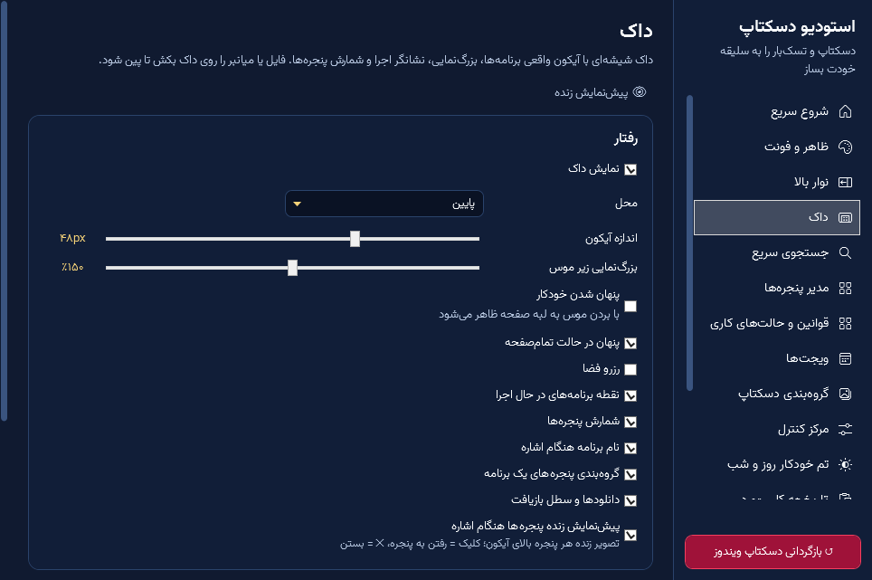

- **پین کردن:** فایل اجرایی، میانبر یا پوشه را روی داک بکشید، یا در استودیو «افزودن برنامه یا میانبر» را بزنید.
- **جابه‌جایی:** آیکون‌های پین‌شده را بکشید.
- **کلیک:** برنامه بسته را باز می‌کند، پنجره باز را جلو می‌آورد یا کوچک می‌کند، و برای چند پنجره فهرست نشان می‌دهد. **کلیک وسط** نسخه تازه باز می‌کند.
- **تصویر زنده پنجره‌ها:** موس را روی آیکون برنامه در حال اجرا نگه دارید تا تصویر زنده همه پنجره‌هایش با دکمه ✕ ظاهر شود.
- **کلیک‌راست:** پین/برداشتن پین، اجرای نسخه جدید، باز کردن محل فایل، بستن همه پنجره‌ها و تنظیمات داک.
- **تنظیمات:** محل (پایین، چپ، راست، بالا)، اندازه آیکون، میزان بزرگ‌نمایی، پنهان شدن خودکار، نقطه اجرا، شمارش پنجره‌ها، دانلودها و سطل بازیافت.

### ۹-۵. جستجوی سریع و تاریخچه کلیپ‌بورد
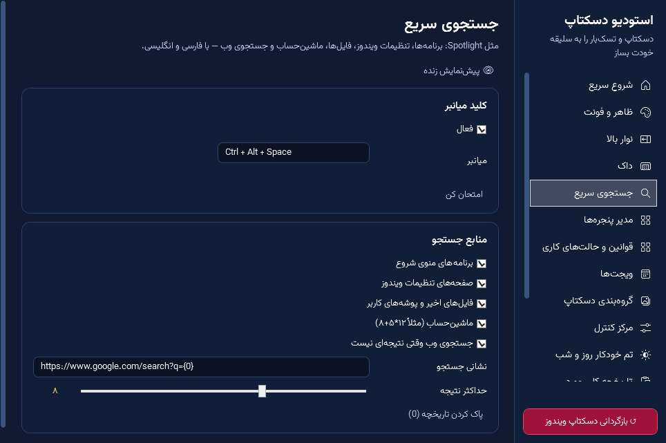

**`Ctrl + Alt + Space`** را بزنید و تایپ کنید:
- **برنامه‌ها:** «کروم»، «word»، «تلگرام».
- **تنظیمات ویندوز:** «وای فای»، «بلوتوث»، «نمایشگر».
- **فایل‌های اخیر** و پوشه‌های کاربر.
- **ماشین‌حساب:** `۱۲*۸+۵`؛ با Enter نتیجه کپی می‌شود.
- **فرمان‌ها:** قفل صفحه، Task Manager، سطل بازیافت، تنظیمات شمسا.
- اگر نتیجه‌ای نبود، **جستجوی وب** انجام می‌شود.

کلیدها: `↑`/`↓` حرکت، `Enter` باز کردن، `Ctrl + Enter` محل فایل، `Tab` تغییر دسته، `Esc` بستن.

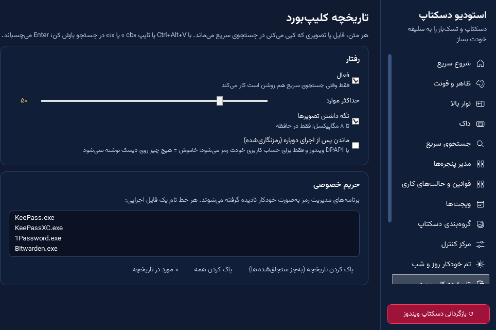

**تاریخچه کلیپ‌بورد:**
- با **`Ctrl + Alt + V`** یا تایپ `cb ` یا `؛` در جستجو باز می‌شود.
- `Enter` مورد انتخاب‌شده را در برنامه قبلی **جای‌گذاری** می‌کند. `Shift + Enter` فقط کپی می‌کند، `Delete` حذف می‌کند و `Ctrl + P` سنجاق می‌کند.
- رمزهایی که مدیران رمز (KeePass، Bitwarden، 1Password …) کپی می‌کنند ثبت نمی‌شوند.
- تاریخچه فقط در حافظه است، مگر اینکه «نگه‌داری پس از بستن» را روشن کنید. در آن صورت فایلش با رمزنگاری ویندوز (DPAPI) ذخیره می‌شود.

### ۹-۶. مدیر پنجره‌ها (کاشی‌کاری)
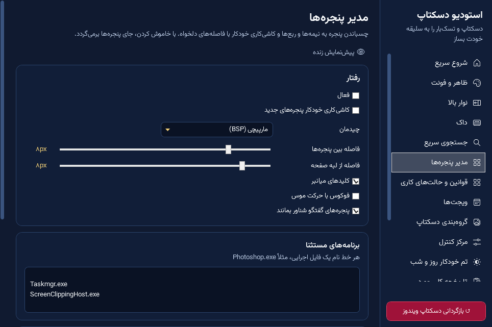

- **چسباندن:** `Ctrl + Alt + ←/→/↑/↓` به نیمه‌ها؛ `Ctrl + Alt + U/I/J/K` به ربع‌ها؛ `Ctrl + Alt + C` وسط صفحه؛ `Ctrl + Alt + Enter` بزرگ با فاصله یا بازگردانی.
- **کاشی‌کاری خودکار** (`Ctrl + Alt + T`): پنجره‌ها خودکار کنار هم چیده می‌شوند. پنج چیدمان (مارپیچی، ستونی، سطری، اصلی + پشته، تک‌پنجره) با `Ctrl + Alt + L` عوض می‌شوند.
- `Ctrl + Alt + F` پنجره را شناور می‌کند، `Ctrl + Alt + [` و `]` بین پنجره‌ها جابه‌جا می‌شود و `Ctrl + Alt + Shift + ←/→` پنجره را با همسایه‌اش عوض می‌کند.
- برای جابه‌جا کردن دو پنجره کاشی‌شده، یکی را روی دیگری بکشید.
- **تنظیمات:** فاصله بین پنجره‌ها و از لبه صفحه، فوکوس با حرکت موس، شناور ماندن پنجره‌های گفتگو و فهرست برنامه‌های مستثنا.
- با خاموش کردن کاشی‌کاری، **همه پنجره‌ها به جای قبلی‌شان برمی‌گردند.**

### ۹-۷. قوانین برنامه‌ها و حالت‌های کاری
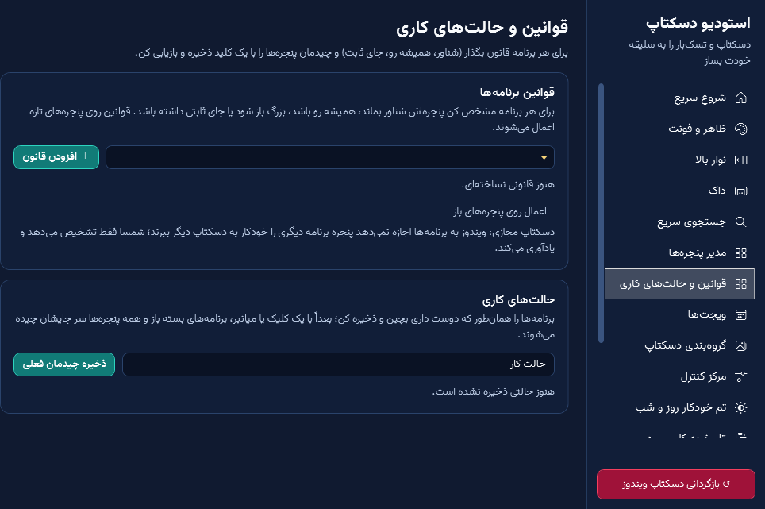

**قانون برای هر برنامه:**
1. «افزودن قانون» را بزنید و برنامه را از فهرست برنامه‌های در حال اجرا انتخاب کنید.
2. انتخاب کنید: **شناور** (هیچ‌وقت کاشی نشود)، **همیشه رو**، **بزرگ باز شود** یا **جای ثابت**. برای جای ثابت، دکمه «استفاده از جای فعلی پنجره» موقعیت فعلی را برمی‌دارد.
3. قانون روی پنجره‌های تازه اعمال می‌شود. دکمه «اعمال روی پنجره‌های باز» آن را روی پنجره‌های فعلی هم اجرا می‌کند.

> ویندوز اجازه نمی‌دهد برنامه دیگری پنجره‌ها را به دسکتاپ مجازی دیگری ببرد. گزینه «دسکتاپ مجازی» فقط یادآوری نشان می‌دهد.

**حالت‌های کاری** (مثلاً «حالت کار»):
1. برنامه‌ها را همان‌طور که دوست دارید بچینید و «ذخیره چیدمان فعلی» را بزنید.
2. برایش نام و کلید میانبر بگذارید. اختیاری: یک چیدمان کاشی‌کاری هم به آن اضافه کنید.
3. با کلید میانبر یا دکمه «بازیابی»، برنامه‌های بسته خودشان باز می‌شوند و هر پنجره سر جای خودش می‌رود.

### ۹-۸. ویجت‌های دسکتاپ
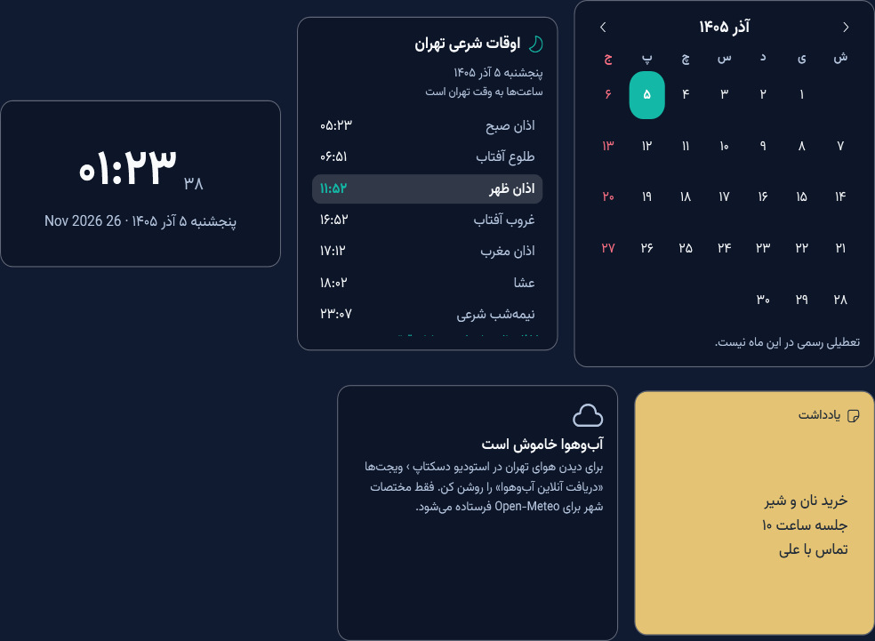

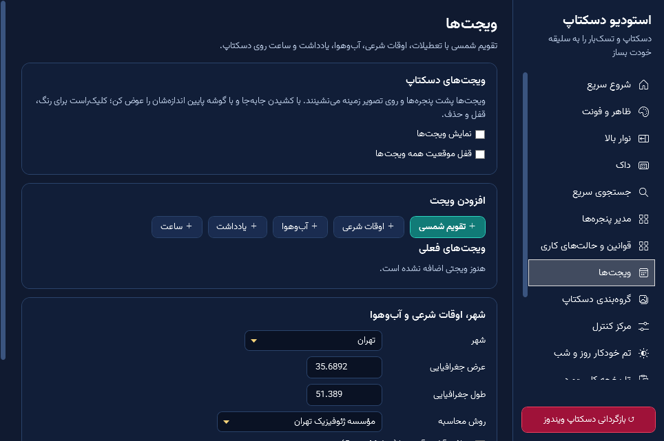

- **تقویم شمسی:** جمعه‌ها و تعطیلات رسمی قرمزند و با اشاره به هر روز مناسبتش دیده می‌شود. تعطیلات قمری محاسباتی است و ممکن است یک روز با اعلام رسمی فرق کند.
- **اوقات شرعی:** اذان صبح تا نیمه‌شب شرعی و شمارش معکوس تا اذان بعدی. ۳۶ شهر آماده هست (شهرهای ایران، کابل، هرات و دوشنبه) یا عرض و طول جغرافیایی دلخواه. ساعت‌ها همیشه به وقت خود شهر است. روش‌های محاسبه: مؤسسه ژئوفیزیک تهران، جعفری، MWL، کراچی و مصر.
- **آب‌وهوا:** فقط وقتی «دریافت آنلاین آب‌وهوا» را روشن کنید، و فقط مختصات شهر به Open-Meteo فرستاده می‌شود.
- **یادداشت:** متن فارسی با رنگ دلخواه که خودکار ذخیره می‌شود.
- **ساعت:** با تاریخ شمسی و میلادی.

ویجت‌ها پشت همه پنجره‌ها روی دسکتاپ می‌نشینند. با کشیدن جابه‌جا و با گوشه پایین بزرگ و کوچک می‌شوند. کلیک‌راست: رنگ، قفل موقعیت، تنظیمات و حذف.

### ۹-۹. گروه‌بندی دسکتاپ (به سبک Fences)
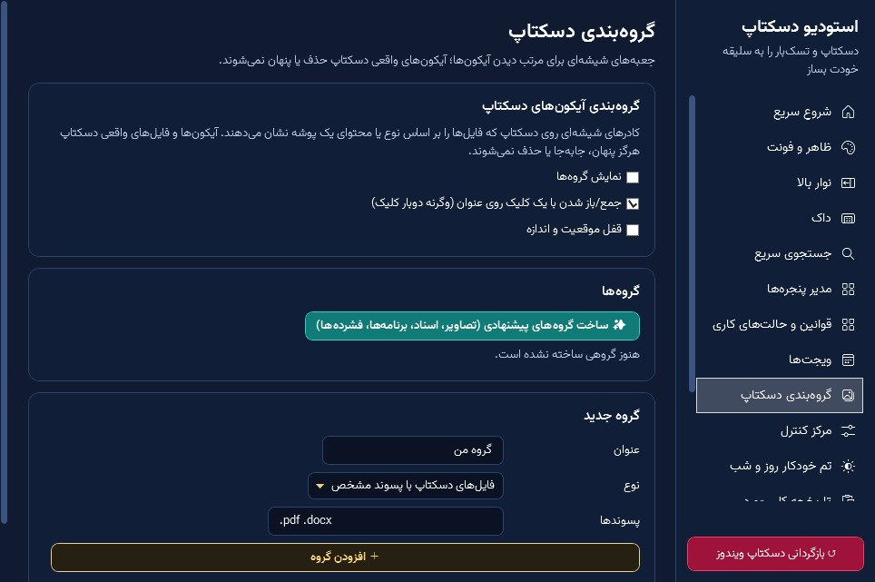

- جعبه‌های شیشه‌ای که آیکون‌های دسکتاپ را دسته‌بندی‌شده نشان می‌دهند. دکمه «افزودن گروه‌های پیشنهادی» چهار گروه آماده می‌سازد: تصاویر، اسناد، برنامه‌ها و میانبرها، فشرده‌ها.
- **دو حالت:**
  - **فیلتر:** فایل‌های دسکتاپ با پسوندهای مشخص.
  - **پوشه:** نمایش محتوای یک پوشه دلخواه، مثل پنجره‌ای به آن پوشه.
- دوبار کلیک باز می‌کند و کلیک روی عنوان، جعبه را جمع می‌کند.
- اگر فایل را روی گروه «پوشه» رها کنید، بعد از تأیید شما به آن پوشه منتقل می‌شود.
- **آیکون‌های واقعی دسکتاپ هیچ‌وقت حذف یا پنهان نمی‌شوند.**

### ۹-۱۰. مرکز کنترل
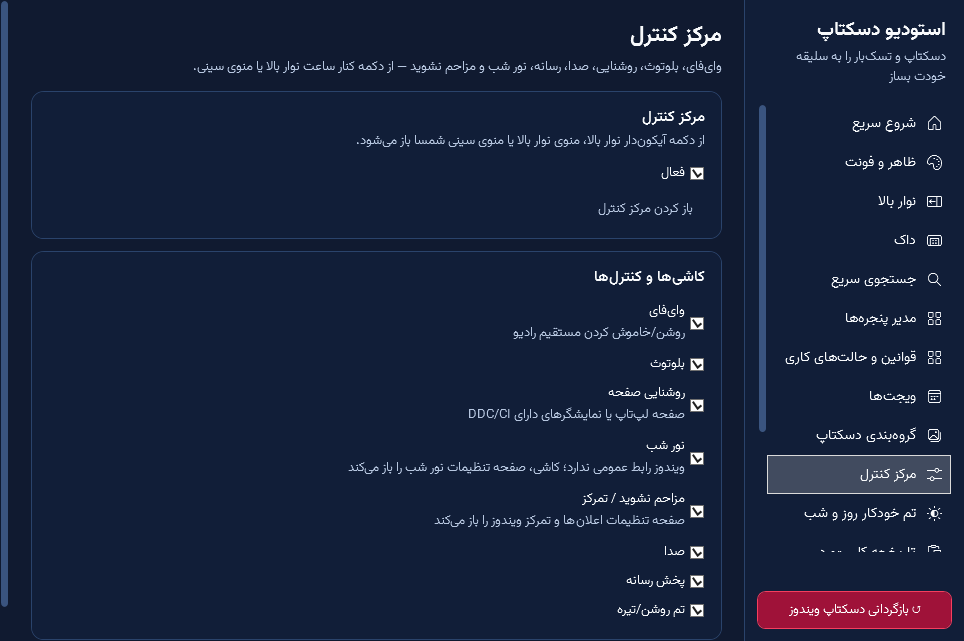

از دکمه کنار ساعت در نوار بالا یا منوی سینی ← «مرکز کنترل» باز می‌شود:
- **وای‌فای و بلوتوث:** روشن و خاموش کردن مستقیم.
- **روشنایی صفحه:** برای لپ‌تاپ‌ها و نمایشگرهایی که DDC/CI دارند. اگر پشتیبانی نشود، اسلایدر غیرفعال است و تنظیمات نمایشگر را باز می‌کند.
- **صدا و پخش رسانه.**
- **تم روشن یا تیره.**
- **نور شب و مزاحم نشوید:** ویندوز راه رسمی برای کنترل مستقیم این دو ندارد، پس این کاشی‌ها صفحه تنظیمات مربوط را باز می‌کنند.
- دکمه‌های قفل صفحه، تنظیمات ویندوز و استودیو.

### ۹-۱۱. فرمان صوتی فارسی
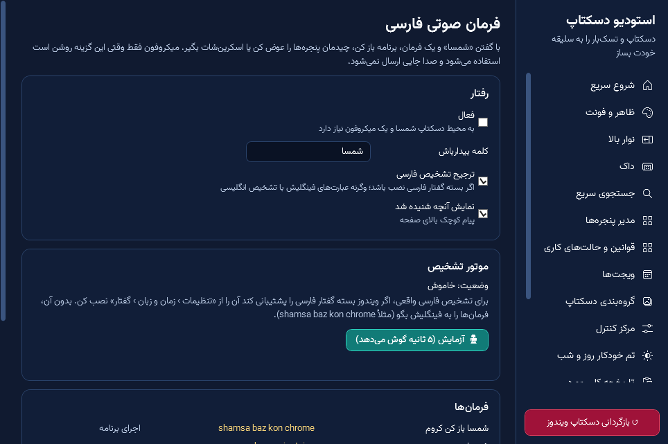

- میکروفون **فقط با روشن کردن این بخش** فعال می‌شود و صدا جایی فرستاده نمی‌شود.
- هر فرمان با کلمه بیدارباش شروع می‌شود (پیش‌فرض «شمسا»):

| فرمان | کار |
|---|---|
| «شمسا باز کن کروم» | باز کردن برنامه |
| «شمسا جستجو» | باز کردن جستجوی سریع |
| «شمسا چیدمان ستونی» (سطری، مارپیچی، تک‌پنجره …) | عوض کردن چیدمان پنجره‌ها |
| «شمسا حالت کار» یا نام یک حالت کاری | بازیابی چیدمان ذخیره‌شده |
| «شمسا اسکرین شات» / «شمسا عکس بگیر» | اسکرین‌شات |
| «شمسا ضبط کن» | ضبط صفحه |
| «شمسا کلیپ بورد» | تاریخچه کلیپ‌بورد |
| «شمسا قفل کن» | قفل صفحه |
| «شمسا تنظیمات» | استودیو دسکتاپ |

> برای تشخیص گفتار **فارسی**، بسته گفتار فارسی ویندوز باید نصب باشد (تنظیمات ← زمان و زبان ← گفتار). بدون آن، فرمان‌ها را به **فینگلیش** بگویید، مثلاً `shamsa baz kon chrome` یا `shamsa jostojoo`. موتور فعال در همین صفحه نمایش داده می‌شود و دکمه «آزمایش» پنج ثانیه گوش می‌دهد.

### ۹-۱۲. تم خودکار روز و شب
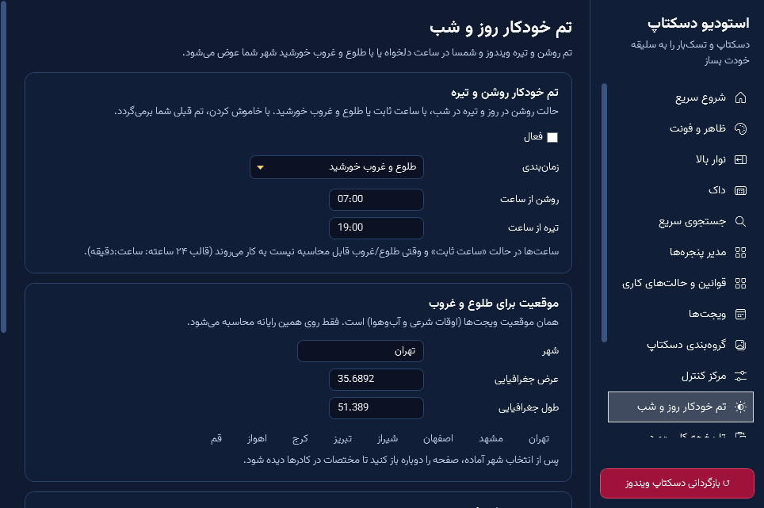

- تم روشن و تیره **ویندوز** و **شمسا** در ساعت دلخواه یا با **طلوع و غروب خورشید** شهرتان (از تنظیمات ویجت‌ها) عوض می‌شود.
- با خاموش کردن این گزینه یا بستن شمسا، تنظیم اصلی ویندوز برمی‌گردد.

### ۹-۱۳. افزونه‌های نوار بالا
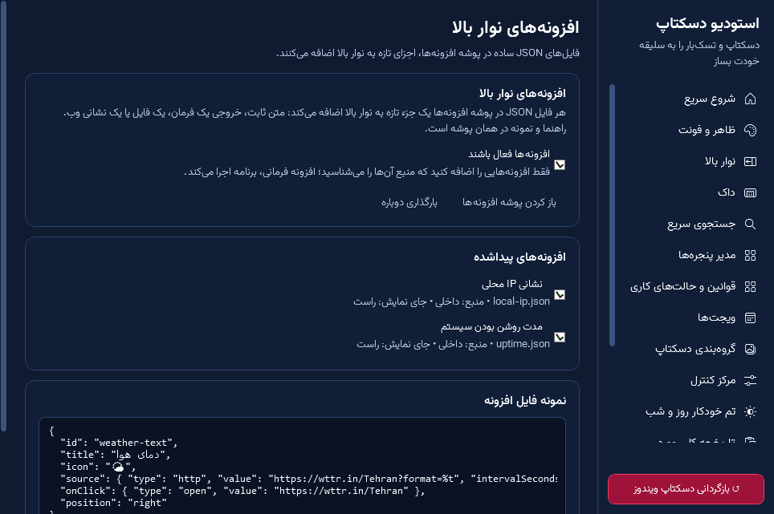

هر فایل JSON در پوشه افزونه‌ها (`%LocalAppData%\Shamsa\plugins`) یک جزء تازه به نوار بالا اضافه می‌کند. دکمه «باز کردن پوشه افزونه‌ها» در همین صفحه است. نمونه:

<div dir="ltr">

```json
{
  "id": "weather-text",
  "title": "دمای هوا",
  "icon": "🌤",
  "source": { "type": "http", "value": "https://wttr.in/Tehran?format=%t", "intervalSeconds": 900 },
  "onClick": { "type": "open", "value": "https://wttr.in/Tehran" },
  "position": "right"
}
```

</div>

- **منبع‌ها:**
  - `builtin` (داخلی: uptime، localip، date)
  - `command` (خروجی یک فرمان، حداکثر ۵ ثانیه)
  - `file` (خط اول یک فایل)
  - `http` (فقط GET)
- فاصله به‌روزرسانی دست‌کم ۱۰ ثانیه است.
- هر افزونه را می‌شود جدا روشن و خاموش کرد.
- **فقط افزونه‌هایی را اضافه کنید که منبعشان را می‌شناسید**، چون افزونه نوع `command` یک برنامه را اجرا می‌کند.
- راهنمای کامل: [`Desktop/Plugins/README-plugins.md`](../Desktop/Plugins/README-plugins.md)

### ۹-۱۴. میانبرها و تداخل‌ها
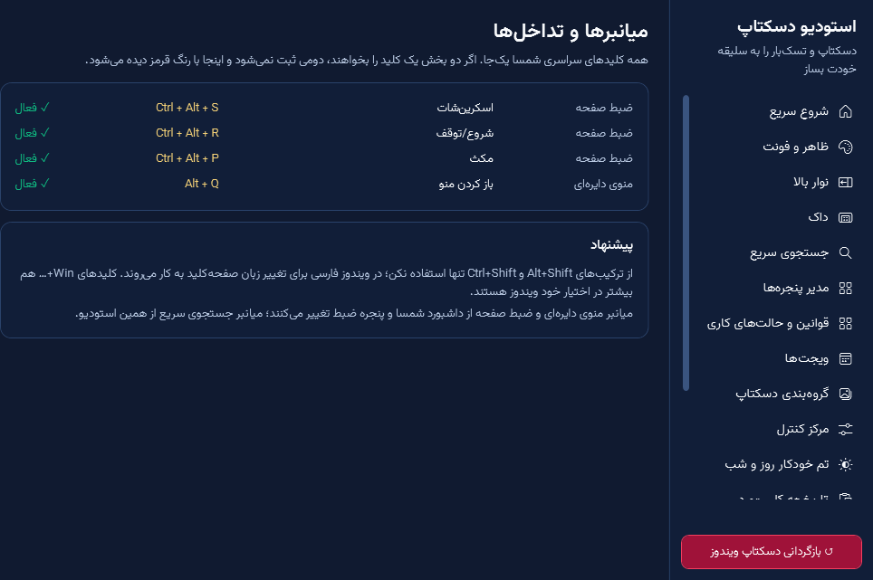

همه کلیدهای سراسری شمسا در یک جدول. اگر دو بخش یک کلید را بخواهند، دومی ثبت نمی‌شود و اینجا با رنگ قرمز دیده می‌شود. اگر برنامه دیگری کلید را گرفته باشد، با رنگ زرد دیده می‌شود. برای تغییر کلید جستجوی سریع، در صفحه «جستجوی سریع» روی کادر کلیک کنید و ترکیب تازه را بزنید. شمسا تداخل را همان لحظه هشدار می‌دهد.

> از ترکیب‌های `Alt + Shift` و `Ctrl + Shift` به‌تنهایی استفاده نکنید؛ در ویندوز فارسی زبان صفحه‌کلید را عوض می‌کنند.

---

## ۱۰. جدول کلیدهای میانبر

| کلید | کار | قابل تغییر از |
|---|---|---|
| `Alt + Q` | منوی دایره‌ای روی فایل‌های انتخاب‌شده | داشبورد ← تنظیمات |
| `Ctrl` + کشیدن فایل | منوی دایره‌ای | — |
| `Ctrl + Alt + R` / `P` / `S` | ضبط / مکث / اسکرین‌شات | پنجره ضبط صفحه |
| `Ctrl + Alt + Space` | جستجوی سریع | استودیو ← جستجوی سریع |
| `Ctrl + Alt + V` | تاریخچه کلیپ‌بورد | — |
| `Ctrl + Alt + ←/→/↑/↓` | چسباندن پنجره به نیمه‌ها | استودیو ← مدیر پنجره‌ها |
| `Ctrl + Alt + U / I / J / K` | ربع‌های صفحه | ″ |
| `Ctrl + Alt + Enter` / `C` | بزرگ با فاصله / وسط صفحه | ″ |
| `Ctrl + Alt + T` / `L` / `F` | کاشی‌کاری خودکار / چیدمان بعدی / شناور | ″ |
| `Ctrl + Alt + [` / `]` | پنجره قبلی / بعدی | ″ |
| `Ctrl + Alt + Shift + ←/→` | جابه‌جایی با همسایه | ″ |
| کلید دلخواه هر حالت کاری | بازیابی چیدمان | استودیو ← قوانین و حالت‌های کاری |

> در صفحه‌کلیدهایی که AltGr دارند، `Ctrl + Alt` همان AltGr است و ممکن است جلوی تایپ بعضی حروف AltGr را بگیرد. در این صورت کلیدهای مدیر پنجره را خاموش کنید.

---

## ۱۱. حریم خصوصی، عیب‌یابی و پرسش‌های رایج

**حریم خصوصی**
- شمسا آفلاین کار می‌کند. فقط این موارد به اینترنت وصل می‌شوند:
  - بررسی به‌روزرسانی در گیت‌هاب
  - آب‌وهوا (اگر روشن کنید)
  - جستجوی وب (اگر خودتان انتخاب کنید)
  - افزونه‌های `http` که خودتان اضافه کرده‌اید
- هیچ آمار یا اطلاعات شخصی فرستاده نمی‌شود.
- تنظیمات و گزارش‌ها در `%LocalAppData%\Shamsa` نگه داشته می‌شوند.

**تسک‌بار ویندوز ناپدید شد؟**
از منوی سینی «بازگردانی دسکتاپ ویندوز» را بزنید، یا این فرمان را اجرا کنید:

<div dir="ltr">

```powershell
& "$env:LOCALAPPDATA\Programs\Shamsa\Shamsa.exe" --restore-desktop
```

</div>

(اگر شمسا را در مسیر دیگری نصب کرده‌اید، همان مسیر را بگذارید.) در اجرای بعدی شمسا هم تسک‌بار خودکار برمی‌گردد.

**پیش‌نمایش ظاهر نمی‌شود؟** در تنظیمات مطمئن شوید پیش‌نمایش آن نوع فایل روشن است. PDFهای رمزدار پیش‌نمایش ندارند.

**کلید میانبر کار نمی‌کند؟** در «استودیو دسکتاپ ← میانبرها و تداخل‌ها» ببینید زرد (گرفته‌شده توسط برنامه دیگر) یا قرمز (تداخل داخلی) است و کلید را عوض کنید.

**اوقات شرعی درست نیست؟** شهر یا مختصات و روش محاسبه را در صفحه ویجت‌ها بررسی کنید.

**فرمان صوتی فارسی را نمی‌فهمد؟** بسته گفتار فارسی ویندوز را نصب کنید یا فرمان‌ها را فینگلیش بگویید.

**گزارش خطا:** فایل‌های گزارش در `%LocalAppData%\Shamsa\logs` هستند. هنگام گزارش مشکل در [Issues](https://github.com/seyedebrahim0211-oss/Shamsa/issues)، آخرین خطوط آن را پیوست کنید.

</div>
